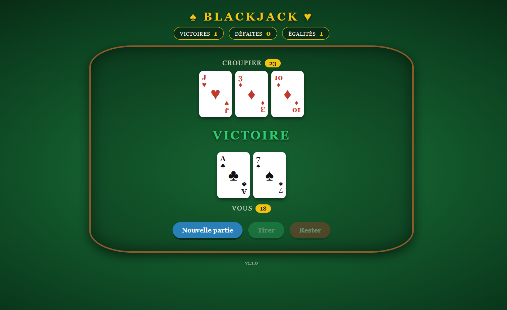

<div align="center">

# ♠️ Blackjack ♥️

**Un jeu de blackjack web, conteneurisé avec Docker et vérifié par une CI.**

[](https://github.com/Timeo-Vl/blackjack-docker/actions)




</div>

---

## 🚀 Lancer en 30 secondes

Seuls **Git** et **Docker** sont nécessaires.

```bash
git clone https://github.com/Timeo-Vl/blackjack-docker.git
cd blackjack-docker
docker compose up -d --build
```

Puis ouvrir **http://localhost:8080** 🎰

Pour arrêter : `docker compose down`

## ✨ Fonctionnalités

- Partie contre le croupier : tirer, rester, valeur des As gérée
- Score cumulé : victoires, défaites, égalités
- Affichage de la version de l'application
- Interface style table de casino, en HTML / CSS / JS pur

## 🛠️ Stack

| Domaine | Outils |
|---|---|
| Application | Node.js, Express |
| Tests | Jest, Supertest |
| Conteneurisation | Docker, Docker Compose |
| CI | GitHub Actions |

## 🧩 Ce que le projet démontre

- **Reproductibilité** : le même environnement partout, fini le « ça marche sur ma machine »
- **CI** : tests et build Docker automatiques à chaque Pull Request
- **Infrastructure as code** : `Dockerfile`, `docker-compose.yml` et `ci.yml` versionnés
- **Versionnage et rollback** : images `blackjack:1.0` et `blackjack:1.1`, retour arrière en changeant le tag
- **Workflow Git** : une branche par fonctionnalité, merge via Pull Request

## 🔄 Changer de version

Le tag de l'image se règle dans `docker-compose.yml` (`image: blackjack:1.1`).

| Situation | Commande |
|---|---|
| Nouvelle version (code modifié, nouveau tag) | `docker compose up -d --build` |
| Retour à une version déjà construite | `docker compose up -d` (sans `--build`) |

## 💻 Développement local

```bash
npm install
npm start     # http://localhost:3000
npm test      # 9 tests
```

## 🔌 API

| Route | Méthode | Description |
|---|---|---|
| `/new` | POST | Démarre une nouvelle partie |
| `/hit` | POST | Tire une carte |
| `/stand` | POST | Reste et laisse jouer le croupier |
| `/state` | GET | État de la partie en cours |
| `/score` | GET | Score cumulé |
| `/version` | GET | Version de l'application |

## 📁 Structure

```
src/                  application (app.js, server.js, public/)
tests/                tests automatiques
Dockerfile            recette de l'image
docker-compose.yml    configuration d'exécution
.github/workflows/    pipeline CI
```

## 🗺️ Pistes d'évolution

- Persistance du score dans un volume Docker
- Une partie et un score par joueur (sessions)
- Publication de l'image sur un registre (ghcr.io) et déploiement en ligne

---

<div align="center">

Projet réalisé dans le cadre du laboratoire DevOps (HELHA) — XP01 : Conteneurisation

</div>